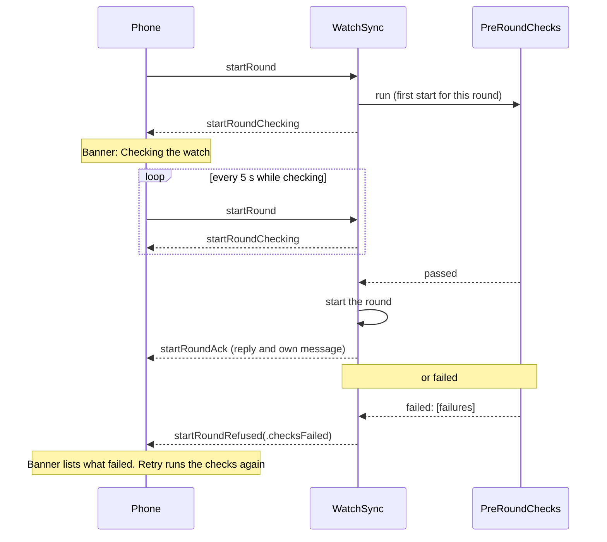

# Pre-round checks and sensor mocks

Branch: `fix/pre-round-checks`.

## Why

At Colorado Golf Club on 2026-10-23 the watch's microphone failed to start on all 20 greens (`-10868 "Input HW format is invalid"`), so no putt was detected. The watch app had stayed open since the day before, and `MicrophoneInput` reused one `AVAudioEngine` for the app's whole life. Its retries and "Restart sensors" reused that broken engine too. Nobody knew until the round was over.

## Decisions

| # | Decision |
|---|---|
| 1 | The microphone starts on a new `AVAudioEngine` every time (done on the branch) |
| 2 | Before the watch accepts a round, `PreRoundChecks` starts every sensor and checks that each one sends real data. If anything fails, the round does not start |
| 3 | `PreRoundChecks` also checks permissions, the workout and a GPS fix. The permission refusal moves out of `WatchSync` into it |
| 4 | During the round the accelerometer runs all round; the microphone and device motion (gyroscope) run only near greens. This is how it works today |
| 5 | The watchdog checks the sensors that are running, and restarts any that stop sending data or send data that is not real (below) |
| 6 | Simulators use mock sensors fed by files. The mocks live in the SensorSources Swift package, now its own repository: https://github.com/SpotGolf/SensorSources |

## Round start



- `WatchSync.startRound` asks `PreRoundChecks` for this round's state: not run or failed → run again and reply `startRoundChecking`; running → reply `startRoundChecking`; passed → start the round and ack, as today. A repeat start for a round already active acks without checks, as today.
- The phone keeps resending the start every 5 s while the state is checking, so a lost ack or refusal is picked up by the next reply. The 15 s "did not respond" timeout does not apply while checking.
- The version check stays in `WatchSync`, before the checks: it is about the message, not the watch.

## `PreRoundChecks`

Watch only, `SpotGolfWatch/Services/PreRoundChecks.swift`, `@MainActor`. It checks permissions, the workout and GPS as well as the sensors, so it sits with the watch's other services rather than in `Sensors`.

```swift
init(sensors: SensorInputs, permissions: PermissionChecker,
     workout: any PreRoundChecks.Workout, location: any PreRoundChecks.Location, limits: Limits = Limits())
func run(roundID: UUID)                                  // calls onFinished(roundID) when it ends
func state(for roundID: UUID) -> PreRoundCheckState      // .notRun, .running, .passed, .failed(StartRoundRefused.Reason)
func received(_ locations: [CLLocation])                 // fixes, forwarded by WatchServices
func releaseSensors()                                    // once the round has started
```

`Workout` and `Location` are small protocols that `WorkoutManager` and `LocationManager` conform to, so the tests use fakes.

The checks run in this order. Each step that fails ends the run with its failure; the steps after it are not run.

| Step | Passes when | Time limit | Failure |
|---|---|---|---|
| Permissions | `PermissionChecker.missing` is empty | none | `.missingPermissions([AppPermission])` |
| Workout | `WorkoutManager.isRunning`. Starts it if it is not | 15 s | `.workoutNotRunning` |
| Sensors, all three at once | Each sends at least one batch of real data (below) through `SensorInputs` | 10 s after the workout runs | `.sensor(name, .notStarted / .noData / .notReal)`, one per failed sensor |
| GPS | A fix with `horizontalAccuracy >= 0` arrives. Location updates start with the sensor step, since a cold GPS start takes longest | 30 s from the start of the sensor step | `.noLocation` |

- The sensors are checked through ordinary `SensorInputs` subscriptions, so the watchdog's restarts (with a new mic engine) happen during the check too.
- The subscriptions are cancelled once the round has started, after the swing detector has subscribed, so the accelerometer is not stopped and started again in between.
- A failed run stops the location updates it started. The workout is left to the existing 3-minute wait for a round.
- A pass that no start uses lets go of the sensors after `passedFor` (120 s).
- The result is logged and recorded as stream events (`preRoundChecksPassed`, `preRoundChecksFailed` with the failure count) so a round's log shows it.

### Real data

One function in the package, `SensorHealth.isReal(_:)`, used by both `PreRoundChecks` and the watchdog:

| Sensor | Real when |
|---|---|
| Accelerometer | Every value is finite, and at least one reading has a magnitude between 0.5 and 4 g (gravity alone is 1 g) |
| Device motion | Every value is finite, and gravity's magnitude is between 0.8 and 1.2 g |
| Microphone | The buffer has frames, every sample is finite, and not every sample is exactly zero (a working mic always has noise) |

## Permissions

- `WatchSync.missingPermissions` and its refusal go away; `WatchSync` gets `preRoundChecks: (UUID) -> PreRoundChecks.State` and `runPreRoundChecks: (UUID) -> Void` closures instead, set by `WatchServices`.
- `PermissionChecker` stays as the reader of permission states: the watch's permissions screen and the phone use it.
- `StartRoundRefused.Reason` gains `.checksFailed([CheckFailure])`. `missingPermissions` stays as its own reason so the phone's banner keeps showing how to grant each one.

`CheckFailure` is a shared `Codable` enum: `workoutNotRunning`, `sensor(name, SensorProblem)`, `noLocation`, with `text` for the phone's banner. `PreRoundCheckState` is shared too, since `WatchSync` is also built into the phone's sync tests.

## Watchdog

`SensorInputs` already restarts a running input that errors or sends nothing for 10 s. Changes:

- A batch that is not real (above) does not count as data, so a mic sending only zeros is restarted like a quiet one.
- The microphone restarts on a new engine (decision 1), so its restarts and "Restart sensors" can now fix it.

## Sensor sources package

[SensorSources](https://github.com/SpotGolf/SensorSources), a Swift package (watchOS 27, iOS 27) in its own repository since version 0.1.0, added to `project.yml` and linked by the watch app and watch tests. It has no SpotGolf code. Paths below are in that repository.

| Part | What |
|---|---|
| Samples | `AccelerometerSample` (uptime, x, y, z in g), `DeviceMotionSample` (uptime, rotation rate, user acceleration, gravity, quaternion), `AudioSample` (host seconds, sample rate, mono `[Float]`: one mic buffer). Every sensor's data type is named `<Sensor>Sample` |
| Protocols | `AccelerometerSource`, `DeviceMotionSource`, `MicrophoneSource`: `start(handler) throws`, `stop()`, `isActive` |
| Live | `CoreMotion` batched accelerometer and device motion, and the `AVAudioEngine` microphone (moved from `MicrophoneInput`) |
| Mock | Baseline data plus clips and controls read from files (below) |
| `SensorSet.make()` | Mock on a simulator, or with the `--sensor-mock` launch argument or `SENSOR_MOCK=1`; live otherwise |
| `SensorHealth` | The real-data check |
| `SensorLog.handler` | Where the sources' log lines go; the watch sends them to its round log |
| `Tools/sensor-mock` | Shell script that sends clips and controls to a simulator |

`SensorInputs` uses the protocols and passes the sample types to its subscribers; microphone subscribers get one `AudioSample` per buffer. `SwingDetector`, `ContactRunner`, `CaptureWriter` and `CaptureAudioWriter` change from `CMAccelerometerData`, `CMDeviceMotion` and `AVReadOnlyAudioPCMBuffer` to the sample types. They use only the fields listed above.

### Mocks: files, not HTTP

Files, because:

- Each simulator app has its own data container, so parallel sessions never collide; an HTTP server would need a port per session.
- No network code, listener or entitlement in the app.
- `xcrun simctl get_app_container` already finds the folder; nothing has to be running on the Mac.

How the mocks work:

- Each mock sends baseline data at the live rate while started: the accelerometer at rest (0, 0, −1 g) with small noise at 800 Hz, device motion at rest at 200 Hz, and low noise from the microphone at 48 kHz in 4096-frame buffers. Batches come about once a second, as on a watch.
- Every 0.5 s the mocks look in `<data container>/Library/SensorMock/Inbox/`:
  - A clip, `<name>.clip/` with any of `accelerometer.csv` (`t,x,y,z`), `motion.csv` (`t,rx,ry,rz,ux,uy,uz,gx,gy,gz,qx,qy,qz,qw`) and `audio.wav` (mono), with `t` in seconds from the clip's start. It plays once in place of the baseline for its sensors, then is deleted.
  - `control.json`, kept until changed: `{"accelerometer": "ok" | "fail" | "silent" | "zeros", ...}` per sensor. `fail` makes `start` throw, `silent` sends nothing, `zeros` sends all-zero data. This tests the checks' failures and the watchdog on a simulator.
- `sensor-mock` copies into a temporary name and renames, so a mock never reads a half-written clip:

```bash
Tools/sensor-mock "SpotGolf Watch <session>" golf.spot.SpotGolf.watchkitapp play swing.clip
Tools/sensor-mock "SpotGolf Watch <session>" golf.spot.SpotGolf.watchkitapp set microphone fail
Tools/sensor-mock "SpotGolf Watch <session>" golf.spot.SpotGolf.watchkitapp reset
```

- GPS needs no mock: `simctl location` already moves the simulator, as `replay-round.py` does.
- Three 4-second clips cut from the Bear Dance capture go in `Examples/`: a putt, a practice stroke and a chip. The capture covers only greens, so it has no full swing; the chip peaks at 13.3 g, which the app counts as a full swing. A one-time script, run from the scratchpad and not checked in, cut them from the capture's Putt Lab files, so the package never reads SpotGolf's capture format. Their audio is from the course and must be listened to for voices before it is committed.

## Phone

| Change | Where |
|---|---|
| `StartState.checking` from the `startRoundChecking` reply; resend every 5 s while checking; no 15 s timeout | `PhoneSync` |
| `StartState.checksFailed([CheckFailure])` from the refusal; waits for Retry or Cancel like other refusals | `PhoneSync` |
| Banner: "Checking the watch…" while checking, and "The watch could not start: microphone not working" (one line per failure) with Retry and Cancel | `RoundSyncBanner` |

## Tests

| Test | Covers |
|---|---|
| `SensorHealthTests` (package) | Real and not real batches for each sensor |
| `MockSourceTests` (package) | Baseline rate and batch size; clip playback replaces the baseline then stops; each mode; the inbox |
| `ExampleClipTests` (package) | Every example clip reads, with all three sensors |
| `PreRoundChecksTests` | Pass; each failure; a failed step skips the rest; a pass expires; the stream event. Uses mock sources and fake workout and location |
| `SensorInputsTests` | Zeros count as data but not real data |
| `SyncFlowTests` | Checking → ack; checking → refused → Retry → ack; resend while checking; lost ack picked up by the next resend |
| `SyncCodecTests` | `startRoundChecking` and `.checksFailed` round trip |
| Existing detector and capture tests | Still pass after the switch to the sample types |

By hand on the real watch: start a round, check the log shows the checks passed and the mic data arrives on the first green. Then leave the app open overnight and start another round.

## Not in this change

- Measuring battery use.
- Running the microphone or device motion all round.
