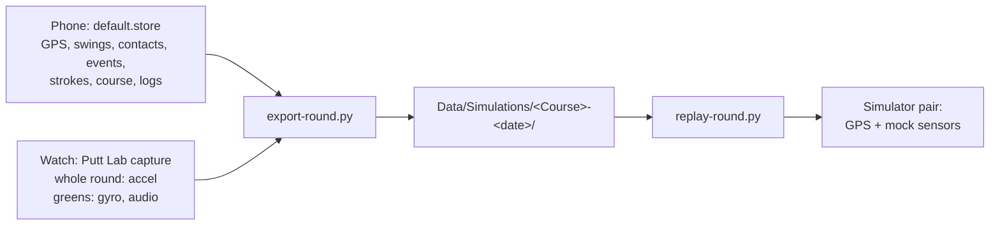

# Round export and replay

Branch: `fix/pre-round-checks`.

## Goal

Export a round from the phone and watch into one folder, then replay that folder on a simulator pair, as often as needed, with one script.



## Decisions

| # | Decision |
|---|---|
| 1 | One round folder holds everything the replay uses, and everything needed to judge it (the strokes the player kept) |
| 2 | `export-round.py` on the Mac pulls the round from the phone and the watch with `devicectl` and writes the folder |
| 3 | The player starts the round by hand on the simulator phone, then runs `replay-round.py` |
| 4 | With Putt Lab During Rounds on, the watch records the accelerometer for the whole round, so every swing replays from real data |
| 5 | Both scripts are written new. Only rounds recorded with this build are exported |

## The round folder

`Data/Simulations/<Course>-<YYYY-MM-DD>/`, git-ignored like the rest of `Data`.

| File | What | Read by |
|---|---|---|
| `simulation.json` | The round: name, course, tee, nines, starting hole, recorded start, duration, the greens (hole, time, length), app version | Both scripts, people |
| `location.csv` | `t,lat,lon,alt,hacc`: every watch GPS fix, `t` in seconds from the start | Replay |
| `clips.csv` | `t,clip`: when each clip starts | Replay |
| `clips/accel-NNNN.clip/` | The whole round's accelerometer in 60 s pieces (`accelerometer.csv`) | Replay |
| `clips/green-NNN-holeN.clip/` | Each green's device motion and audio (`motion.csv`, `audio.wav`) | Replay |
| `course.json` | The course as the round used it (`CourseSelection`) | People; a later automatic round start |
| `strokes.csv` | `hole,stroke,lat,lon,club,quality,penalties,hitAt,origin`: the strokes the player kept | Comparing a replay |
| `stream/` | The round's stream from the phone: `fixes.csv`, `swings.csv`, `contacts.csv`, `events.csv` | Comparing a replay |
| `log.csv` | The round's log lines from both devices | Comparing a replay |

- The accelerometer comes in 60 s pieces so a mock reads about 2 MB at a time instead of a whole round (300 MB as CSV).
- Audio timing comes from `audio-buffers.csv`, which has each buffer's host time, so mic gaps become silence in the right place.

## `export-round.py`

Repository root, Python standard library only.

```bash
Scripts/export-round.py --list                                  # rounds on the phone
Scripts/export-round.py [--round <ID or YYYY-MM-DD>] [--phone <UDID>] [--watch <UDID>] [--to <folder>]
```

1. Copies the phone's `default.store` (with `-wal` and `-shm`) with `devicectl`. Picks the round by ID or date; the latest ended round when none is given.
2. Decodes the round's stream records (fix, swing, contact, event) and reads its course, tee, nines, starting hole, strokes and log lines.
3. Copies the round's Putt Lab capture from the watch (matched by `roundID` in its `meta.json`) with `devicectl`, and checks each file's size against `meta.json`. It stops when the round has no capture, since the replay needs one.
4. Lines up capture time with the round's clock from `startDate` and `startUptime` in each `meta.json`.
5. Writes the folder. It replaces an existing folder for the same round only with `--force`.

The phone and watch default to the first paired iPhone and Apple Watch that `devicectl` lists. Both must be on the same network as the Mac.

## `replay-round.py`

Plays the round folder's GPS fixes through `simctl location`, and its green clips and swings through the watch's mock sensors.

```bash
Scripts/replay-round.py <round folder> [--from MIN] [--to MIN] [--watch <simulator>] [--phone <simulator>]
Scripts/replay-round.py <round folder> --holes                  # where each hole and green starts
```

- Defaults to the click-testing pair, `SpotGolf Watch` and `SpotGolf Phone`; a Claude session passes its own clones.
- Sets both simulators to the first GPS fix, then asks to continue once the round is started on the phone.
- Plays in real time; `--from` and `--to` pick a part.
- Stops at the end of the data, at `--to`, when the phone's round ends, or on Ctrl-C.

The phone picks the course from CourseData as usual, so the round's course must be there.

## Watch: accelerometer for the whole round

| Change | Where |
|---|---|
| A round capture with Putt Lab During Rounds on writes `round/accel.bin` (20-byte records: `t` Float64, `x y z` Float32) and `round/meta.json` (`startDate` to the millisecond, `startUptime`, `roundID`) from round start to round end | `PuttCaptureRecorder`, `CaptureWriter` |
| It subscribes to the accelerometer, which runs all round anyway, so it adds writing, not sensor use | `PuttCaptureRecorder` |
| It stops writing below the capture's free-space floor and logs it | `PuttCaptureRecorder` |
| Green segments no longer write `accel.bin`; the round file has it | `PuttCaptureRecorder` |

About 288 MB for a 5-hour round. The Captures page deletes a capture, which removes it.

## Tests

| Test | Covers |
|---|---|
| `CaptureWriterTests` | The round accelerometer file and its meta |
| `PuttCaptureRecorderTests` | The round file starts and ends with the round, only with Putt Lab During Rounds on; segments have no `accel.bin` |
| `export-round.py --self-test` | Stream decoding, capture alignment, accelerometer pieces, audio placed from buffer host times, against small files in `TestFixtures/round-export/` |
| By hand | Play a round with this build, export it, replay two holes on a session's simulators, and check the watch's swings and putts against `stream/` |

## Not in this change

- Starting the round automatically from `course.json`.
- Running replays faster than real time.
- Comparing a replay's suggestions with `strokes.csv` automatically.
